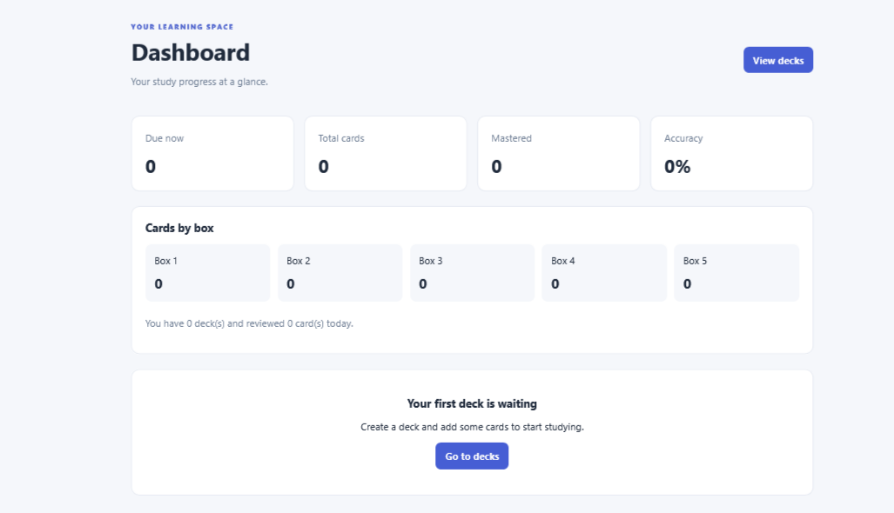
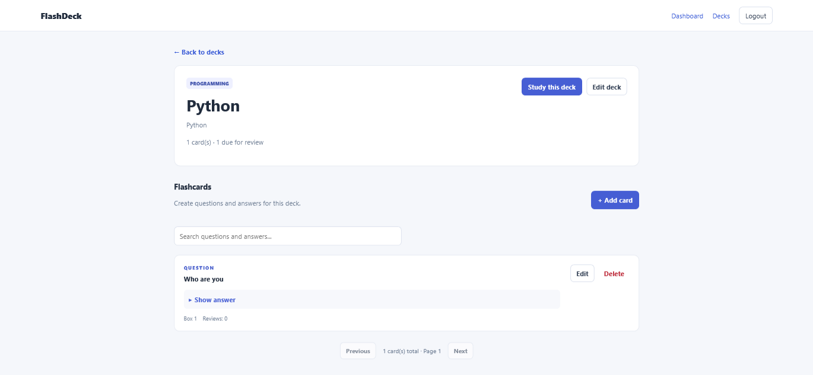

# FlashDeck Frontend

A React frontend for the FlashDeck spaced-repetition study
application.

## Tech Stack

- React
- Vite
- React Router
- Axios
- CSS

## Local Setup

1. Install Node.js.
2. Install dependencies with `npm install`.
3. Create `.env` using `.env.example`.
4. Set VITE_API_URL to your local Django API.
5. Start the development server with `npm run dev`.

## Environment Variables

| Variable     | Purpose                    |
| ------------ | -------------------------- |
| VITE_API_URL | Base URL of the Django API |

## Design Direction

To be completed during frontend development.

## Backend

Backend repository: Add your backend GitHub URL here.

# SCREENSHOTS

	
